<p align="center">
  
</p>

<p align="center">
  
</p>

<p align="center">
  <a href="https://www.linkedin.com/in/meghnarajput10/"></a>
  <a href="mailto:rajputmeghna9@gmail.com"></a>
  <a href="https://career-script.vercel.app"></a>
  
</p>

---

## 👩‍💻 About Me

I'm an **MCA student at Vellore Institute of Technology** who likes the part of software most people never see — APIs, data models, caching, auth, and the plumbing that keeps data consistent.

```java
public class Meghna {
    String education   = "MCA @ VIT Vellore";
    String focus       = "Backend Engineering · Full-Stack Development";
    String[] exploring = { "System Design", "Event-driven architecture", "Applied ML / Computer Vision" };
    String dailyHabit  = "DSA in Java";
    boolean openTo     = true; // internships & SDE roles
}
```

---

## 🛠️ Tech Stack

| Area | Tools |
|---|---|
| **Languages** |  |
| **Backend** |  |
| **Frontend** |  |
| **Databases** |  |
| **DevOps & Tools** |  |

---

## 📌 Featured Projects

<table>
<tr>
<td width="50%" valign="top">

### 📝 CareerScript
**Full-stack resume builder**

Build a resume from customizable templates with a live, interactive editor. JWT-based auth and Redis caching on an Express + MongoDB backend.

`React` `Node.js` `Express` `MongoDB` `Redis` `JWT`

[](https://career-script.vercel.app)
[](https://github.com/Mmeghna10/CareerScript)

</td>
<td width="50%" valign="top">

### 🎓 PlacementHub
**Campus placement management system**

A centralized platform for students, recruiters and placement cells, built on a layered Spring Boot backend with role-based access via Spring Security.

`Java` `Spring Boot` `Spring Security` `MySQL` `React`

[](https://github.com/Mmeghna10/placementhub)

</td>
</tr>
<tr>
<td width="50%" valign="top">

### 🅿️ Neopark
**Parking management system**

Models real parking workflows — slots, bookings and status — with real-time updates, Redis for fast state, and a Dockerized setup.

`JavaScript` `Node.js` `MongoDB` `Redis` `Docker`

[](https://github.com/Mmeghna10/Neopark)

</td>
<td width="50%" valign="top">

### ✈️ TravelByChance
**Travel & accommodation platform**

Discover stays, manage listings and handle bookings and reviews, with a REST backend on Express and MongoDB.

`JavaScript` `Node.js` `Express` `MongoDB`

[](https://github.com/Mmeghna10/travel-by-chance)

</td>
</tr>
</table>

**Also:** [Meeting Summarizer](https://github.com/Mmeghna10/meeting-summarizer) — an AI-assisted workflow that turns meeting notes into organized summaries.

---

## 🧠 Problem Solving & Interests

<table>
<tr>
<td width="50%" valign="top">

**DSA in Java** — practising daily across

- Arrays & Strings · Sliding Window · Hashing
- Linked Lists · Two Pointers
- Trees & Graphs · DFS / BFS
- Dynamic Programming

</td>
<td width="50%" valign="top">

**Areas I'm exploring**

- System Design & scalable backends
- Event-driven architecture
- AI / ML and Computer Vision
- Federated Learning & Differential Privacy

</td>
</tr>
</table>

<!-- Optional: add your LeetCode card (replace YOUR_LEETCODE_USERNAME)
<p align="center">
  
</p>
-->

---

## 📊 GitHub Stats

<p align="center">
  
  
</p>

<p align="center">
  
</p>

<p align="center"><sub>Cards are generated by this repo's own GitHub Action and refresh daily.</sub></p>

---

## 🤝 Let's Connect

I'm open to **internships and entry-level SDE / backend roles**. If you're building something interesting, I'd love to hear about it.

<p align="center">
  <a href="https://www.linkedin.com/in/meghnarajput10/"></a>
  <a href="mailto:rajputmeghna9@gmail.com"></a>
  <a href="https://github.com/Mmeghna10"></a>
</p>

<p align="center">
  
</p>
